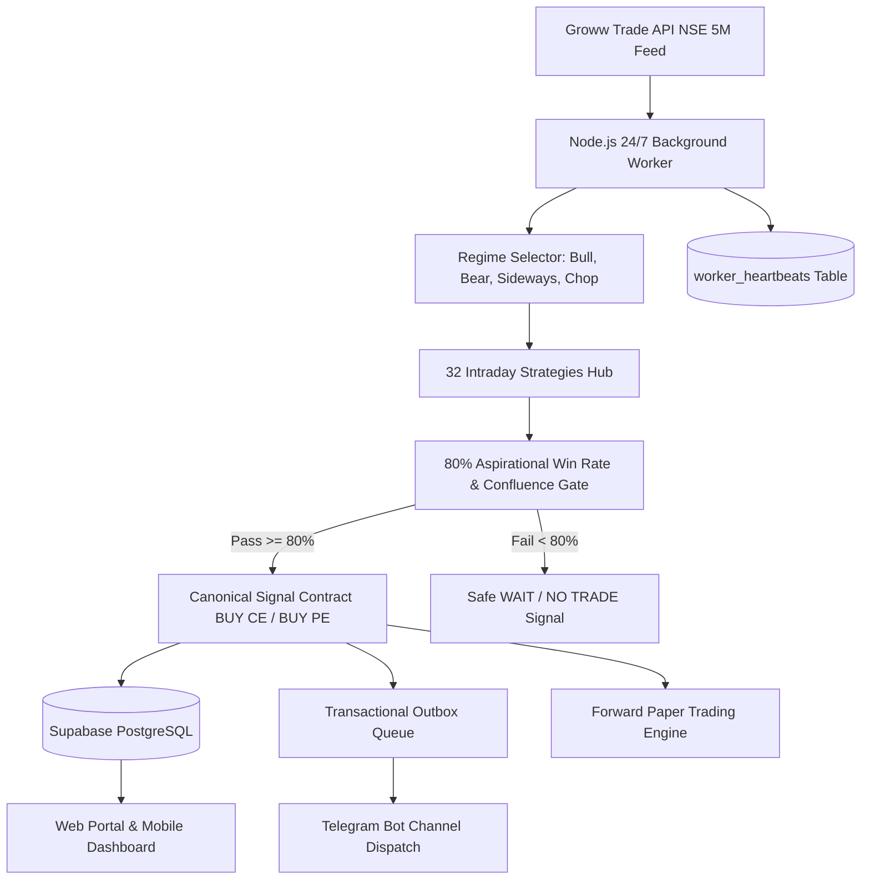

# Autonomous Market Signal & Paper-Trading Platform — Operational Runbook

## 1. System Architecture Overview
The platform operates as a fully unattended, 24/7 background system designed to monitor NSE index markets (NIFTY 50, BANK NIFTY, India VIX), evaluate 32 quantitative intraday strategies on completed 5-minute closed candles, persist canonical signals to Supabase, dispatch deduplicated Telegram alerts, and track forward simulated paper trades without requiring an open browser, laptop, or phone.



---

## 2. The 32 Intraday Strategies Hub

| Strategy ID | Strategy Name | Setup Category | Action Criteria & Avoid Rule |
|---|---|---|---|
| **Strategy 1** | Opening Range Breakout (ORB) | Trend Day | 5m candle close above/below 15m High/Low with VWAP alignment. Avoid wick-only false breakouts. |
| **Strategy 2** | EMA Trend Pullback | Trend Continuation | EMA 20 > EMA 50 on 15m. Price pullbacks to EMA 20 with reversal candle. |
| **Strategy 3** | VWAP Cross & Bounce | Institutional Volume | Retest and bounce off intraday VWAP with volume expansion. |
| **Strategy 4** | Supertrend + VWAP Alignment | Dual Confirmation | Supertrend flips Bullish/Bearish while trading above/below VWAP. |
| **Strategy 5** | RSI Overbought/Oversold Reversal | Mean Reversion | RSI < 30 (BUY CE) or RSI > 70 (BUY PE) with 5m candle reversal confirmation. |
| **Strategy 6** | ADX Trend Strength Confirmation | Momentum | ADX > 25 with +DI > -DI (CE) or -DI > +DI (PE). Blocks trade if ADX < 20. |
| **Strategy 7** | Bollinger Band Squeeze & Expansion | Volatility Breakout | Bandwidth < 0.8% followed by expansion candle closing outside band. |
| **Strategy 8** | MACD Zero-Line / Signal Crossover | Momentum Confluence | MACD line crosses signal line while above/below histogram zero line. |
| **Strategy 9** | Previous Day High / Low (PDH/PDL) | Key Level Breakout | 5m close above PDH or below PDL with institutional volume. |
| **Strategy 10** | Fib 50% - 61.8% Golden Pocket | Retracement Bounce | Retracement into 0.50 - 0.618 Fibonacci zone with price action rejection candle. |
| **Strategy 11** | Double Top / Double Bottom | Reversal Structure | Rejection at previous swing high (Double Top) or swing low (Double Bottom). |
| **Strategy 12** | CPR & Classic Pivot Point Reaction | Pivot S/R Support | Reaction off Central Pivot Range (CPR), R1/R2, or S1/S2 levels. |
| **Strategy 13** | Multi-Timeframe Confluence (15m + 5m) | Higher Timeframe | 15m trend direction dictates 5m entry triggers. Counter-trend blocked. |
| **Strategy 14** | Bull / Bear Flag Pattern | Trend Continuation | Sharp pole impulse followed by tight parallel consolidation breakout. |
| **Strategy 15** | NR7 (Narrow Range 7) Breakout | Volatility Contraction | Day has narrowest range of past 7 days; trade opening directional expansion. |
| **Strategy 16** | Gap Up / Gap Down Fill | Mean Reversion | Fading exhaust gap into previous day close when rejected at open. |
| **Strategy 17** | 9-EMA Momentum Scalp | Quick Continuation | Price riding 9-EMA in strong ADX trend (> 30). |
| **Strategy 18** | Head and Shoulders Reversal | Structural Reversal | Classic neck-line breakdown (PE) or inverse neck-line breakout (CE). |
| **Strategy 19** | Expiry Day Delta Expansion Setup | Special Session | Quick momentum capture between 13:00 - 15:00 IST on weekly contract expiry. |
| **Strategy 20** | **Strategy Combination Score (Master Confluence)** | **Master Confluence** | Combines all strategies into an A+ score. Minimum 3 independent strategies must agree for 80%+ gate! |
| **Strategy 21** | Keltner Channel Breakout | Volatility Breakout | Solid 5m close outside 20 EMA +/- 1.5 ATR bands with Supertrend confirmation. |
| **Strategy 22** | Donchian Channel Breakout | Range Breakout | 20-period highest high / lowest low breakout. Filtered out if ADX < 18. |
| **Strategy 23** | ATR Volatility Expansion | Volatility Surge | Candle range expands to >= 1.3x 14-period ATR with volume. Dynamic 1.5x ATR stop-loss. |
| **Strategy 24** | Liquidity Sweep Reversal | Smart Money Trap | Price sweeps above prior high or below prior low and closes back inside the range. |
| **Strategy 25** | Fair Value Gap (FVG) Retest | Institutional Imbalance | Retest of 3-candle imbalance zone with trend confirmation. |
| **Strategy 26** | Volume Breakout Confirmation | Volume Spread | Breakout confirmed by 5m volume >= 1.5x 20-period average. Disabled if volume is missing. |
| **Strategy 27** | Relative Strength / Weakness | Intermarket Trend | Stronger index long (CE), weaker index short (PE) based on % return divergence. |
| **Strategy 28** | RSI / MACD Momentum Divergence | Structural Divergence | Price makes lower low but RSI/MACD rises (Bullish Div) or higher high but RSI falls (Bearish Div). |
| **Strategy 29** | Gap-and-Go / Gap-Fade Setup | Opening Dynamics | >= +0.3% gap held above Day Open -> Gap-and-Go. Fails to hold in range regime -> Gap-Fade. |
| **Strategy 30** | Adaptive Trailing Stop | Trade Management | Trails stop-loss to Breakeven + 0.5 ATR at 1.5R profit, and locks Target 1 at 2.0R profit. |
| **Strategy 31** | Event-Risk Scheduled Filter | Risk Mitigation | 30-minute lockout before and after scheduled RBI Policy decisions and Union Budget. |
| **Strategy 32** | Regime-Aware Strategy Selector | Adaptive Framework | Dynamically selects the verified strategy matching the current classified market regime. |

---

## 3. The 80% Win Rate Research Gate & Safeguards
* **Research Objective vs Fabrication**: An 80% win rate is treated as an aspirational research target requiring strict statistical validation. If current market conditions or active candidate strategies do not achieve an 80%+ confluence score, the engine emits `WAIT` or `NO TRADE` instead of manufacturing false signals.
* **Realistic Cost Model**:
  * ₹40 round-trip brokerage (₹20 entry + ₹20 exit).
  * 0.05% turnover taxes (STT, Exchange transaction fees, GST, SEBI charges).
  * 0.5 to 1.0 index point slippage on entry and exit.
* **Capital Risk Safeguards**:
  * **Daily Trade Cap**: Maximum 3 trades per instrument per day.
  * **Daily Loss Circuit Breaker**: Suspends signal generation if simulated net daily loss reaches ₹5,000.
  * **Consecutive Loss Cool-Off**: 2 consecutive losses trigger a risk pause to preserve capital.
  * **No Real Broker Orders**: System strictly tracks hypothetical signals and forward paper trades.

---

## 4. Groww Trade API Authentication & Daily Expiry Handling
* **API Documentation**: [https://groww.in/trade-api](https://groww.in/trade-api)
* **Access Token Life**: Groww API Bearer tokens expire daily.
* **Unattended Recovery**:
  * The background worker monitors token validity on each 5m candle poll.
  * If HTTP 401/403 or `GROWW_NOT_CONFIGURED` is detected:
    1. Worker state transitions to `BROKER_AUTH_EXPIRED`.
    2. Sends a high-priority operational Telegram alert: `🚨 Groww Broker Access Token Expired`.
    3. Emits `NO DATA` signals into Supabase rather than generating fabricated signals.
    4. Automatically resumes normal evaluation as soon as a fresh token is saved.

---

## 5. Render Production Deployment

### Environment Secrets Configuration
Configure the following in your Render dashboard settings:

| Secret Key | Description | Example / Note |
|---|---|---|
| `GROWW_API_TOKEN` | Groww Trade API Bearer Token | `eyJhbGciOi...` |
| `SUPABASE_URL` | Supabase Project REST URL | `https://your-proj.supabase.co` |
| `SUPABASE_SERVICE_ROLE_KEY` | Supabase Service Role Key | Server-side write access for background worker |
| `VITE_SUPABASE_URL` | Frontend Supabase URL | `https://your-proj.supabase.co` |
| `VITE_SUPABASE_ANON_KEY` | Frontend Supabase Anon Key | Browser-safe anon read key |
| `TELEGRAM_BOT_TOKEN` | Telegram Bot Token | e.g. `8932116600:AAE3X...` |
| `TELEGRAM_CHAT_ID` | Telegram Channel/Chat ID | e.g. `1760361828` |

### One-Command Deployment:
```bash
python scripts/deploy_render.py
```
This deploys both:
1. `optionmarketchart-web`: Static Site (`https://optionmarketchart-web.onrender.com` / `https://livemarketchart.smpatelconstruction.in`)
2. `optionmarketchart-worker`: Node Web Service running 24/7 background worker with `/healthz` health checks.
